<div align="center">

# [DirectX9] Mad Mullet Jack 모작

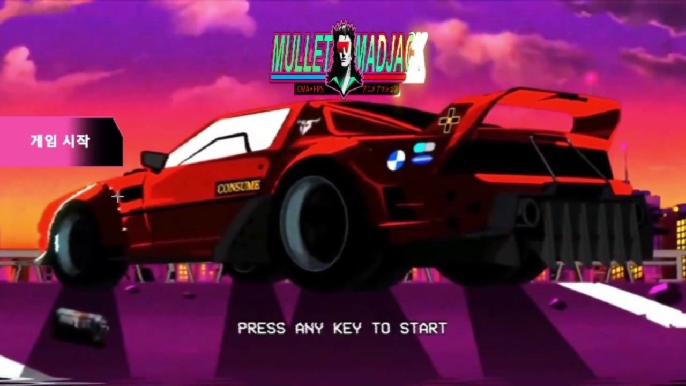

**직접 설계한 DirectX9 엔진 위에서 만든 1인칭 하이퍼 액션 슈터**

개발기간 : 2025.08.12 ~ 2025.09.16 (약 1개월)

개발인원 : 3명 (클라이언트 3인)

개발환경 : C++ / DirectX9 / Visual Studio · 외부 라이브러리 : ImGui, ImGuizmo, FMOD

</div>

<br>

# *동영상 / GitHub*

[Mad Mullet Jack 모작 포트폴리오 영상](https://youtu.be/C-_J7oHs68g)

[GitHub](https://github.com/johwoong/MadMulletJack.git)

# *프로젝트 소개*

**Mad Mullet Jack** 은 좁은 건물 내부, 옥상, 달리는 차량 위를 질주하며 몰려오는 적을 처치하는 **1인칭 하이퍼 액션 슈터**입니다.
짧은 시간 안에 빠르게 적을 처치해 시간을 벌고, 스테이지를 클리어할 때마다 **카드 업그레이드**를 선택해 점점 강해지는 것이 핵심입니다.

기존 상용 엔진을 사용하지 않고 **DirectX9 기반 엔진(Engine.dll)과 맵 에디터(Editor)를 직접 제작**한 뒤,
그 위에 원작의 전투 · UI · 연출을 재현하는 것을 목표로 했습니다.

### 모작 포인트

- 2D 스프라이트(빌보드)와 3D 공간을 섞은 **원작 특유의 카툰풍 FPS 연출**
- 헤드샷 · 콤보 · 슬로모션 · 킥 등 **스피디한 전투 시스템**
- 스테이지 클리어 후 선택하는 **카드형 업그레이드 상점**
- 튜토리얼 → 일반 스테이지 → 스나이퍼 → 보스 → 차량 전투로 이어지는 **스테이지 구성**

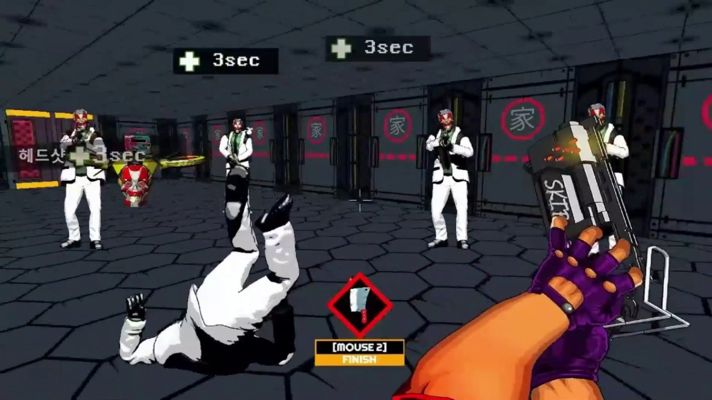 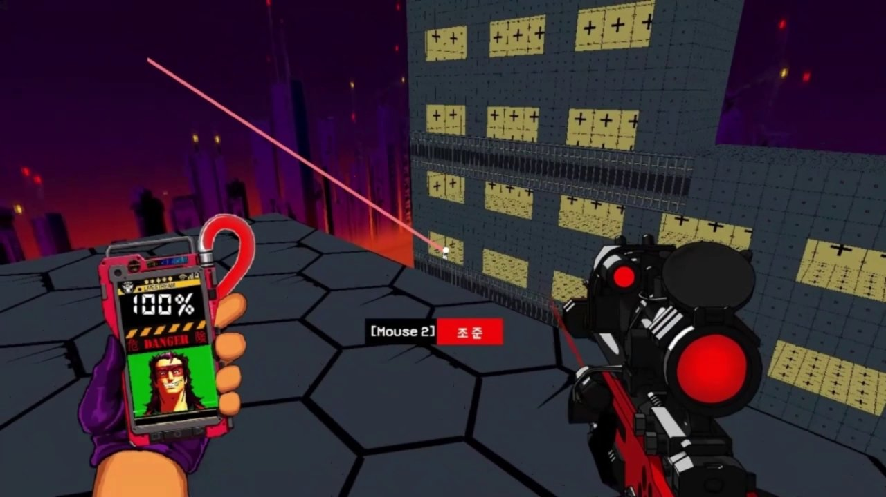

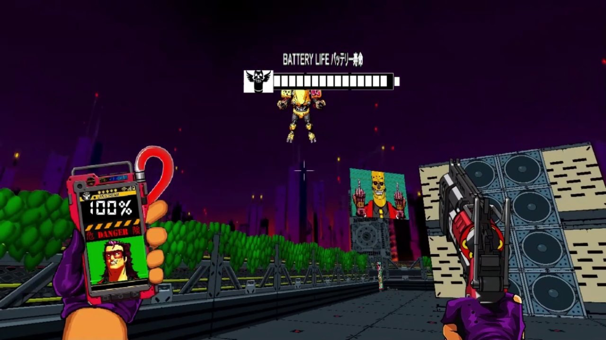 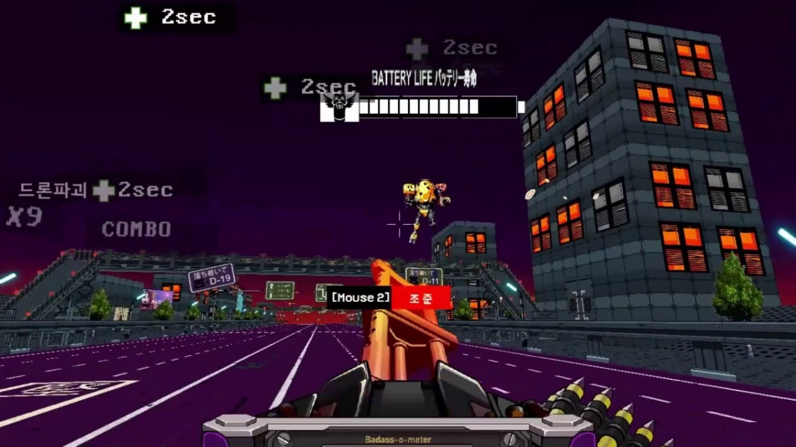

<br>

# *팀 구성 및 담당파트*

| 이름 | 담당 파트 |
|---|---|
| **조한웅** | UI 시스템, 몬스터 시스템 · 부위 판정, 충돌 / 피킹, 프러스텀 컬링, 로고 · 로딩 · 튜토리얼 · 스나이퍼 씬, 칼 콤보, 사운드 매니저, 영상 재생 |
| **강병준** | 맵 에디터, 지형 · 벽 충돌, 스테이지 맵 제작, 오브젝트 풀링 · 이펙트, 보스 |
| **김은비** | 플레이어, 무기, 카메라, 아이템 · 드랍, 플레이어 · 무기 사운드 |

> 아래 `담당 구현 내용` 은 **조한웅** 이 구현한 파트를 중심으로 정리했습니다.

<br>

# *게임 주요 사진*

### 스테이지 구성

스테이지는 크게 **튜토리얼 · 일반 스테이지 · 스나이퍼 · 보스 · 차량** 으로 구성되어 있습니다.

| Scene | 설명 |
|---|---|
| Logo / Loading | 타이틀 화면과 로딩 씬 |
| Tutorial | 이동, 사격, 무기, 업그레이드 사용법을 단계별로 안내 |
| Stage 1 / Stage 2 | 일반 몬스터를 처치하며 진행하는 메인 스테이지 |
| Snipe | 스나이퍼 소총으로 원거리 적을 처치하는 스테이지 |
| Boss | 총기 · 미사일 패턴을 사용하는 보스전 |
| Car | 이동하는 차량 위에서 진행되는 전투 스테이지 |

| Tutorial | Stage 1 |
|:---:|:---:|
| 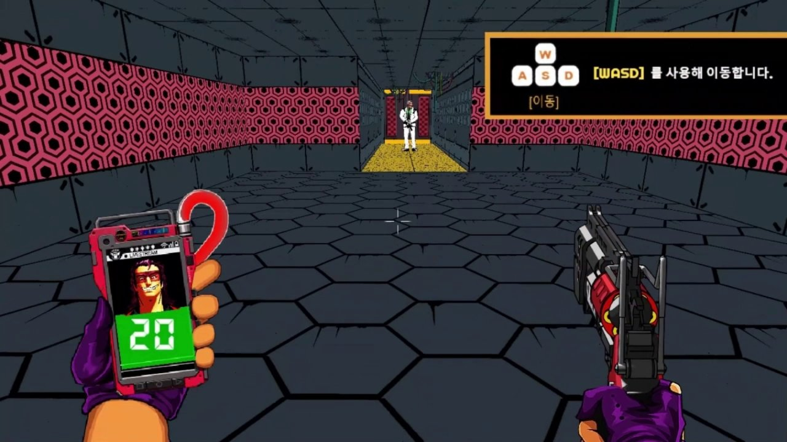 | 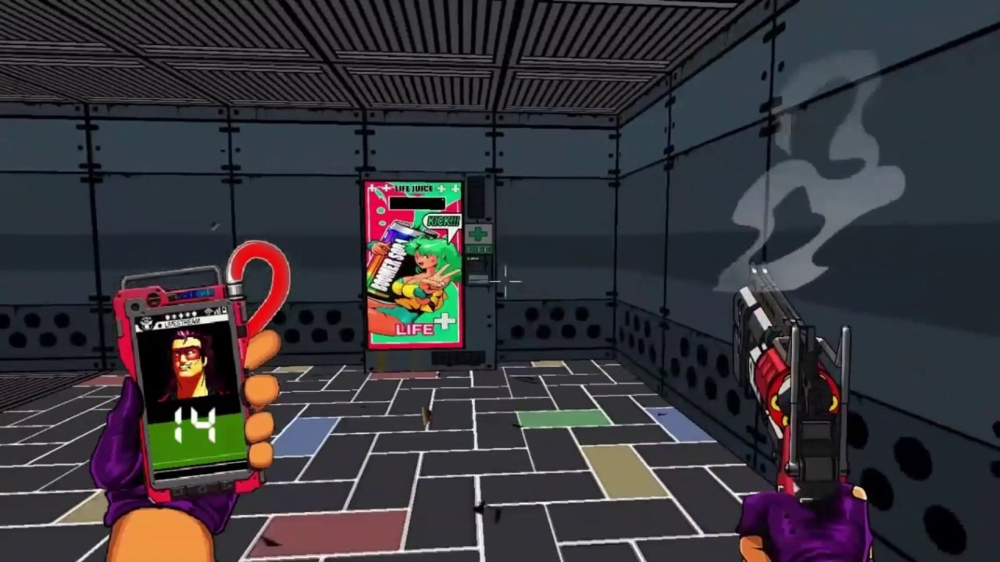 |
| **Stage 2** | **Snipe** |
| 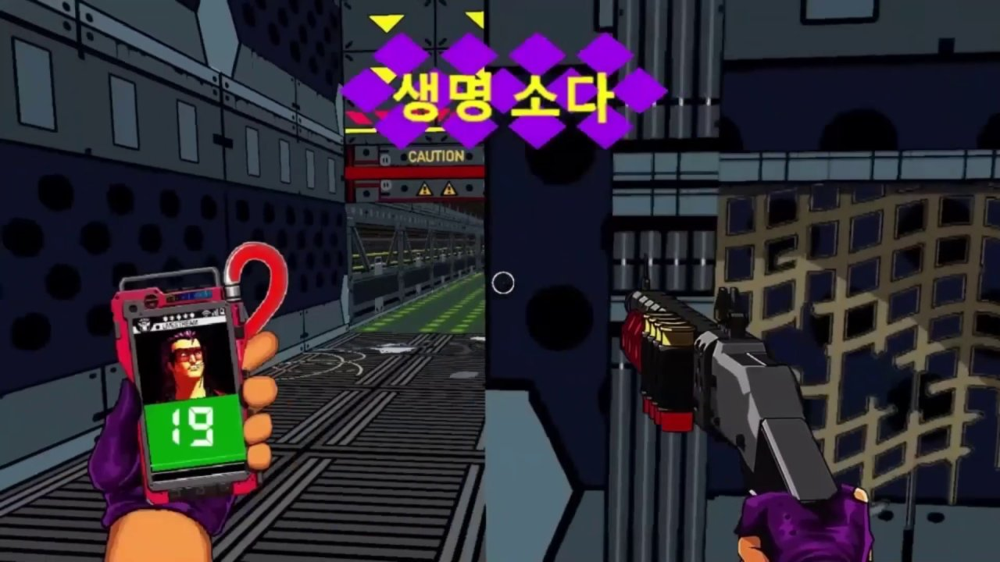 |  |
| **Boss** | **Car** |
|  |  |

<br>

# *게임 플레이 설명*

## 1. 게임 흐름

```
Logo → Loading → Tutorial / Stage → (클리어 · 카드 상점) → Snipe → Loading → Boss → Loading → Car
```

- 각 스테이지에서 적을 모두 처치하면 **클리어 UI** 가 출력되고 다음 스테이지로 로딩됩니다.
- 클리어 후에는 **카드 상점(Choose Your Upgrade)** 에서 업그레이드를 선택합니다.

<!-- 📷 게임 흐름도 or 플레이 GIF

-->

## 2. 플레이어 액션

| 액션 | 설명 |
|---|---|
| 이동 | W A S D 이동, Shift 대시, Space 점프 |
| 사격 | 마우스 클릭, R 재장전 |
| 킥 | 근접 적에게 발차기 |
| 슬라이드 / 벽 이동 | 지형에 따라 슬라이드 · 벽 타기 · 대시 점프 등 이동 상태 전환 |
| 줌 / 슬로모션 | 줌 상태에서 시간 감속 |
| 도핑 | 아이템 사용으로 회복 및 강화 |

> 키 설정은 실제 게임 내 설정과 맞는지 확인해 주세요.

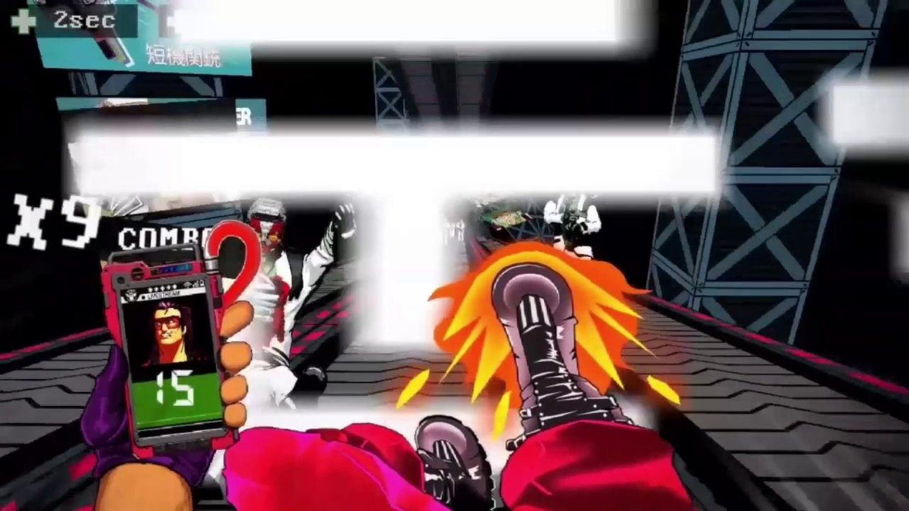 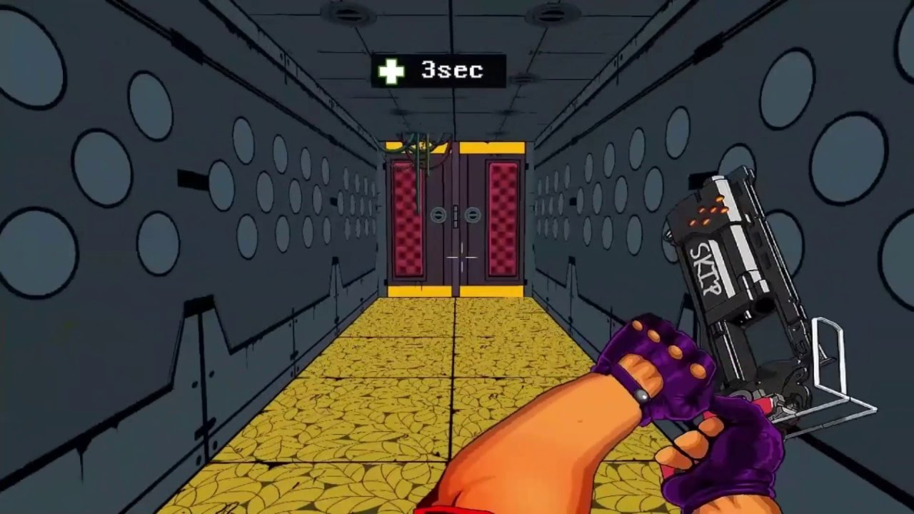

## 3. 무기

| 무기 | 특징 |
|---|---|
| Pistol | 기본 무기, 빠른 연사 (탄창 9발) |
| Shotgun | 근거리 광범위 피해 (탄창 6발) |
| Mini Gun | 지속 연사 |
| Sniper | 줌 기반 원거리 저격 |
| Katana | 근접 무기 |
| Knife / Kick | 서브 근접 공격 |

- 무기마다 **전용 UI, 쿨타임, 사운드, 탄 / 피격 이펙트** 가 적용되어 있습니다.

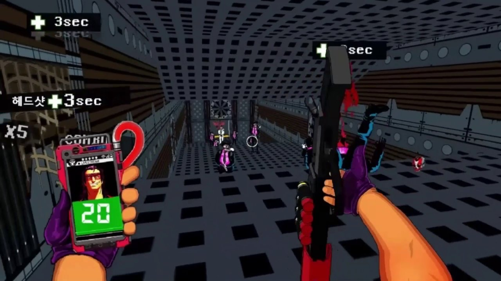 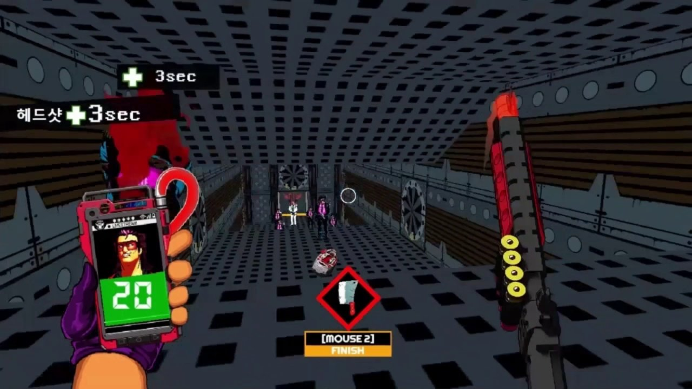

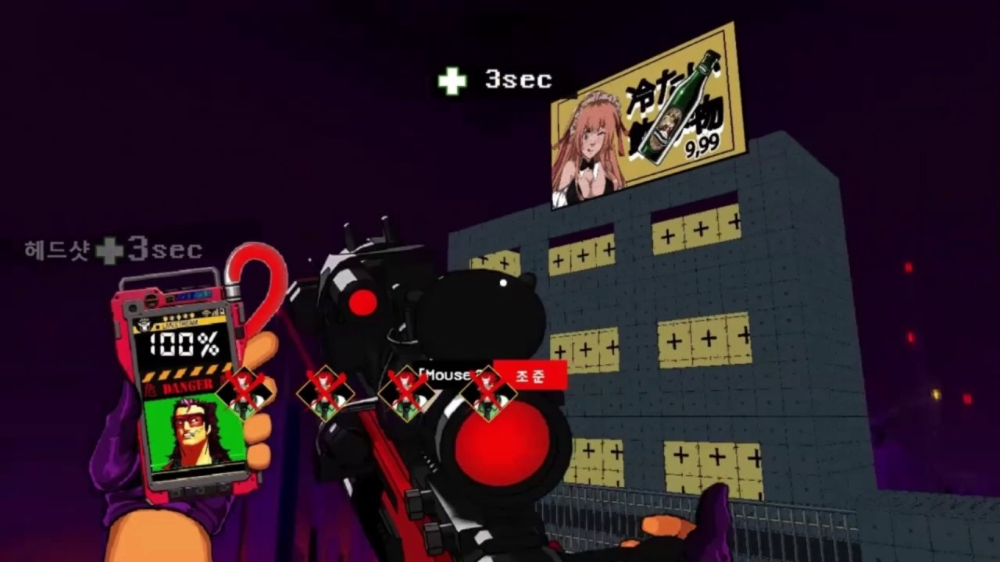 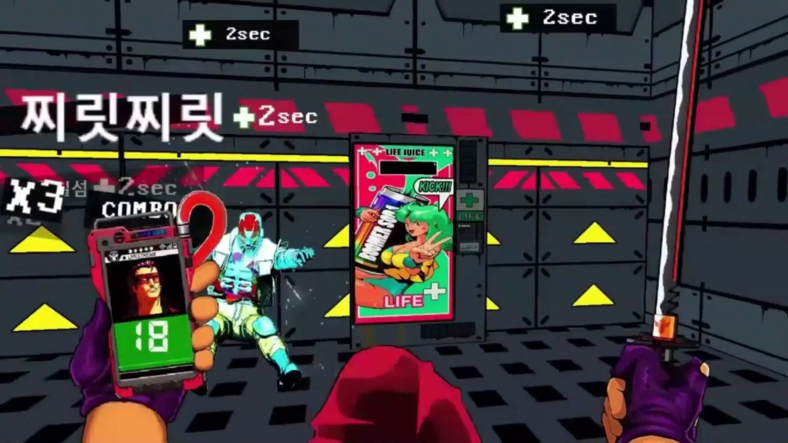

## 4. 몬스터 / 보스

| 종류 | 설명 |
|---|---|
| Suit | 정장 차림 근접 · 원거리 몬스터 |
| Soldier | 총기를 사용하는 병사 |
| Fat | 덩치가 큰 몬스터 |
| Drone | 공중에서 공격하는 드론 |
| Boss | 총기 · 미사일 · 방어 패턴, 경고 원 표시 후 미사일 발사 |

- **헤드샷 / 바디샷 부위 판정** : 부위에 따라 데미지와 처치 연출이 달라집니다.
- 헤드샷 시 머리 폭발 이펙트와 전용 사운드, 헤드샷 처치 UI 가 출력됩니다.
- 사망 시 일정 확률로 **아이템 드랍**, 일부 지형 오브젝트(전기, 산성, 유리 등)를 이용한 환경 처치도 가능합니다.

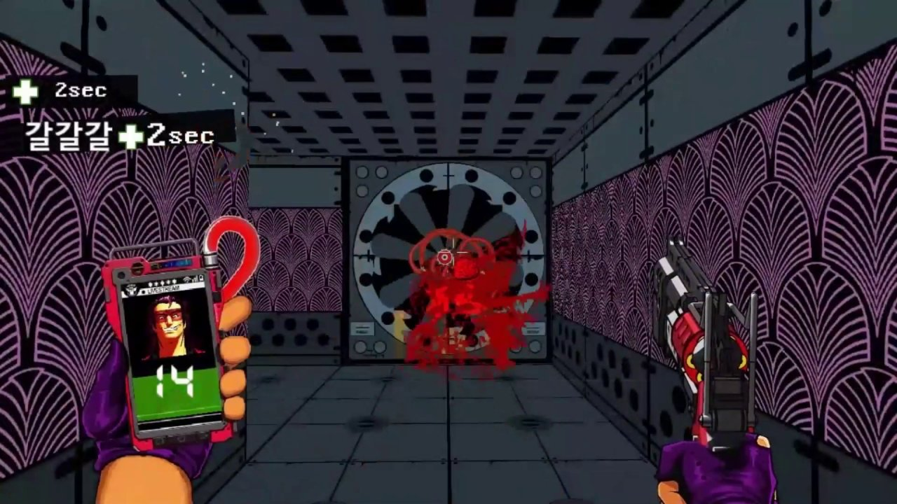 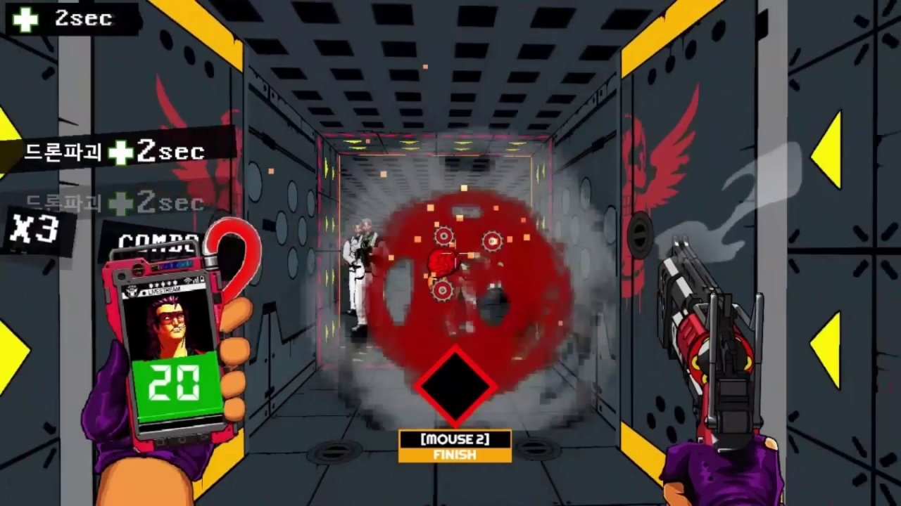

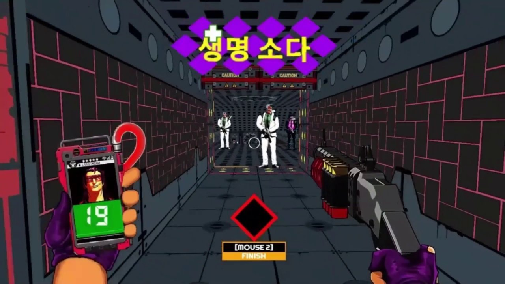 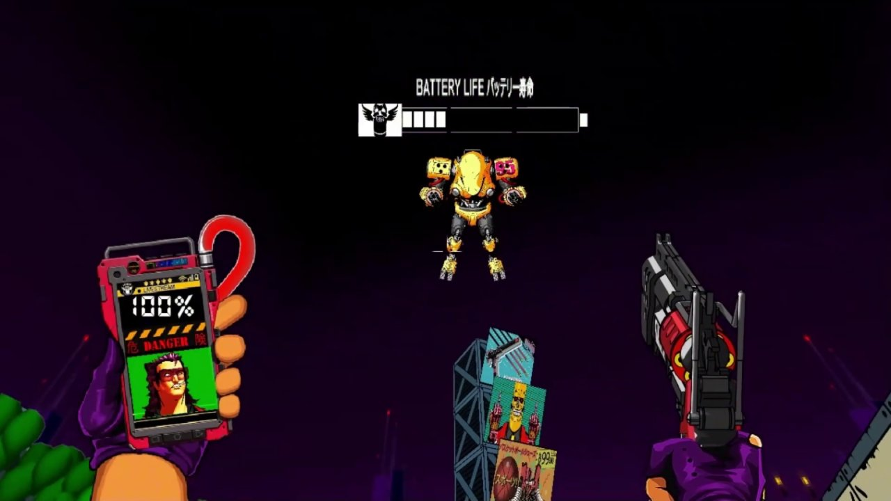

## 5. 맵 구성 요소 (Tile)

일반 벽과 바닥 외에 다음 기믹 타일이 배치됩니다.

`유리` · `산성(Acid)` · `전기(Electric)` · `환풍구(Vent)` · `일반 문` · `전투 후 열리는 문` · `디스플레이` · `병` · `자판기`

- 자판기를 통해 **아이템**을 얻을 수 있고, 문은 적을 모두 처치하면 열립니다.

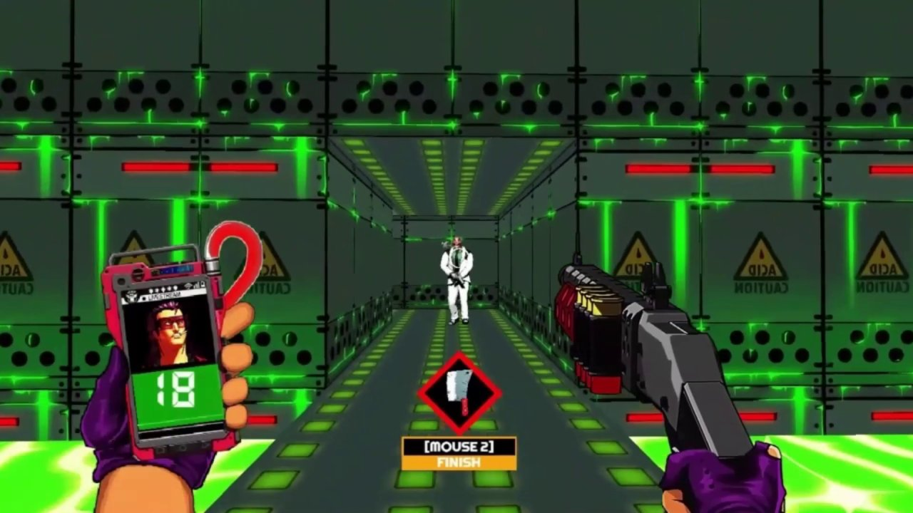 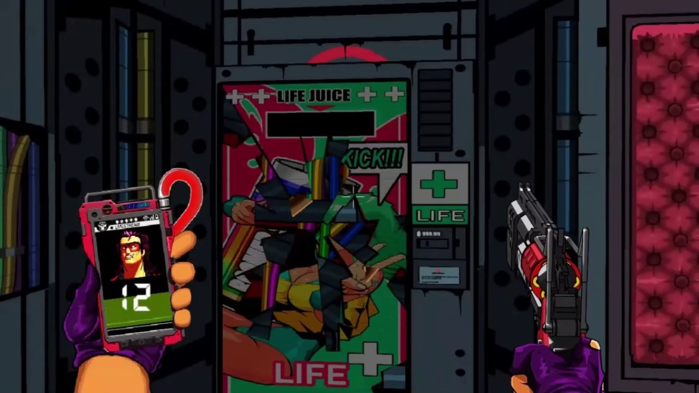

## 6. 카드 업그레이드 상점

- 스테이지 클리어 후 **3장의 카드** 중 하나를 선택합니다.
- 업그레이드 종류 : `SlowMo`, `FIRE`, `SHOTGUN`, `HEADSHOT`, `SNIPER`, `KATANA`, `SPEED`
- 씬마다 제시되는 카드 목록이 다르며, 선택에 따라 사용할 수 있는 무기와 능력이 달라집니다.

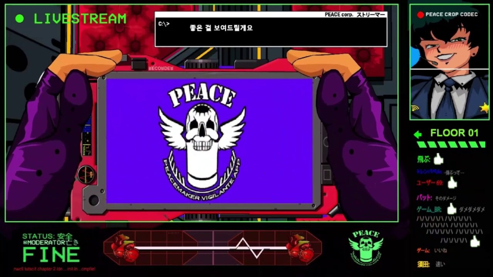 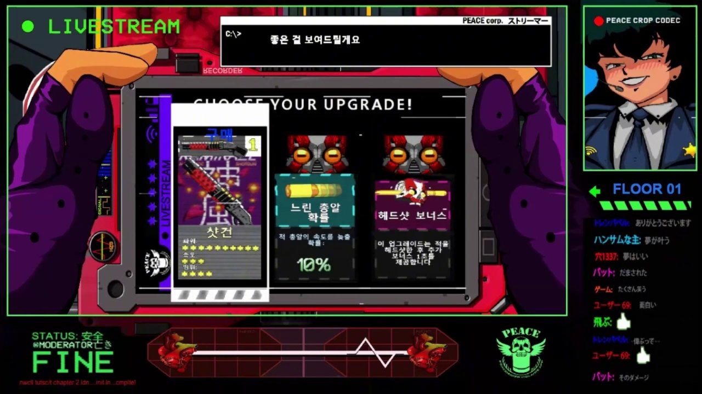

## 7. UI / 연출

- **HUD** : 체력, 시간, 무기 · 쿨타임, 조준점, 폰 UI
- **전투 연출** : 처치 UI, 헤드샷 UI, 콤보 UI, 클리어 UI, 피격 · 회복 이펙트
- **튜토리얼 UI** : 단계별 안내와 진행도 추적
- **보스 HP 바**

 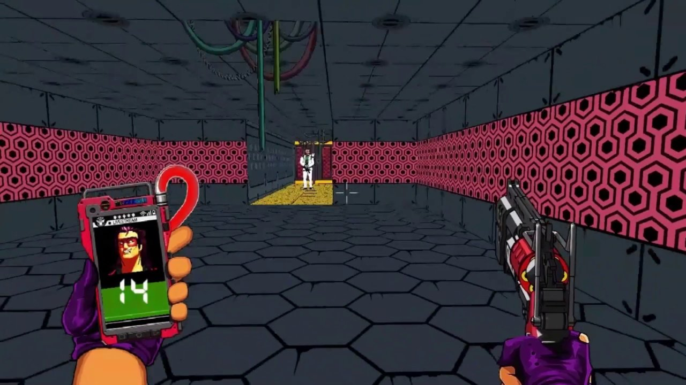

<br>

# *시스템 구조*

```
MadMulletJack
├─ Base/        CBase (참조 카운트 기반 최상위 클래스)
├─ Engine/      Engine.dll  - 렌더링 · 씬/오브젝트 관리 · 충돌 · 피킹 · 컬링 · 사운드 · 풀링
├─ Client/      Client.exe  - 플레이어 · 무기 · 몬스터 · 보스 · UI · 스테이지
├─ Editor/      Editor.exe  - ImGui 기반 맵 / 프리팹 에디터
├─ GameData/    에디터로 제작한 레이어별 맵 데이터 (Tile, Wall, Env, Monster, Prefab)
└─ Reference/   엔진 헤더 및 라이브러리 공유 폴더
```

```
CManagement (Singleton)
  └─ Scene
       └─ Layer
            └─ GameObject
                 └─ Component (Transform, Texture, VIBuffer, Collider ...)
```

<!-- 📷 클래스 다이어그램 (루트 ClassDiagram.cd 내보내기)

-->

- Engine 은 DLL 로 분리하여 **Client 와 Editor 가 동일한 엔진 코드를 공유**합니다.
- 모든 객체는 `CBase` 를 상속하며 **레퍼런스 카운트(AddRef / Release)** 로 수명을 관리합니다.

<br>

# *담당 구현 내용 (조한웅)*

> 팀 프로젝트 중 제가 직접 구현한 파트를 정리했습니다. 담당 : **UI 시스템 · 몬스터 시스템 · 충돌 / 피킹 · 컬링 · 씬 구성(로고 / 로딩 / 튜토리얼 / 스나이퍼) · 칼 콤보 · 사운드 · 영상 재생**

<br>

## 1. UI 시스템

게임의 모든 UI 를 **하나의 상속 구조와 매니저**로 묶어, 새로운 UI 를 만들 때 생성 · 배치 · 애니메이션 · 삭제를 같은 방식으로 처리할 수 있게 설계했습니다.

```
CUIBase ─ CUI ─ CImageUI / CTextUI / CButtonUI / CPanelUI / CGridPanel ...
                 ├─ 연출      : CBannerUI, CEffectUI, CTextEffectUI, CTalkUI
                 ├─ 핸드폰    : CPhoneUI, CLisaUI (스트리머 캐릭터)
                 ├─ 튜토리얼  : CTutorialUI, CTutorialTracker
                 └─ 인벤/상점 : CItemUI, CHeartUI ...
CUIManager (Singleton) : UI 생성 / 삭제 / 애니메이션 / 상점 총괄
```

### UI 애니메이션 (트윈)

- `AddSlideIn`, `AddSlideTo`, `AddScaleIn` 으로 **delay / duration 을 지정**하는 UI 트윈을 구현했습니다.
- 자식 UI 를 트리 순회(DFS)로 모아 `delay` 를 조금씩 늘려 가며 적용해, 한 번의 호출로 **순차적으로 밀려 나가고 들어오는 연출**을 만들었습니다.

### 처치 연출 UI

 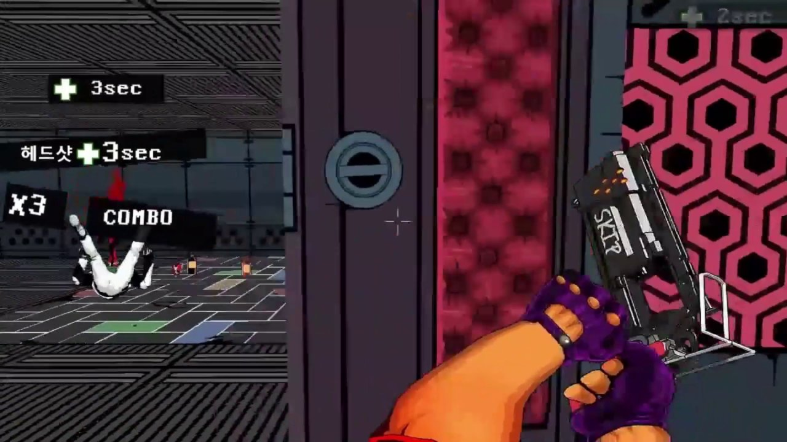

- 몬스터 처치 시 `QueueDeathUI` 로 연출을 예약하고, **따라다니는 UI → 배너 UI → 콤보 UI** 순서로 생성합니다.
- **헤드샷 / 일반 처치에 따라 문구와 연출이 달라지며**, 처치 간격을 기록해 연속 처치 시 `X3 COMBO` 와 같이 콤보 수를 표시합니다.
- 몬스터 종류마다 `GetDeathUIConfig` 를 재정의해 배너 문구 · 색을 다르게 설정할 수 있습니다.

### 핸드폰 UI / 카드 업그레이드 상점

 

- 스테이지 클리어 시 핸드폰이 등장하고, 스트리머(`CLisaUI`)의 표정 · 머리카락 파츠가 **상태(AnimState)에 따라 변하는 UI** 를 구현했습니다.
- 핸드폰 화면에서 **카드 상점**이 열리며, 씬별 업그레이드 목록(`SlowMo`, `FIRE`, `SHOTGUN`, `HEADSHOT`, `SNIPER`, `KATANA`, `SPEED`)을 **테이블로 관리**합니다.
- 카드 클릭(`OnShopCardClicked`) 시 선택한 업그레이드가 적용됩니다.

### 튜토리얼 UI

 

- `CTutorialTracker` 가 **이동 → 사격 → 점프 → 대시 → 마무리 → 문 → 소다** 단계(`TStep`)를 추적하고, 단계가 바뀔 때마다 `CTutorialUI` 가 슬라이드 인으로 안내 문구와 이미지를 갱신합니다.

### 클리어 / 아이템 UI

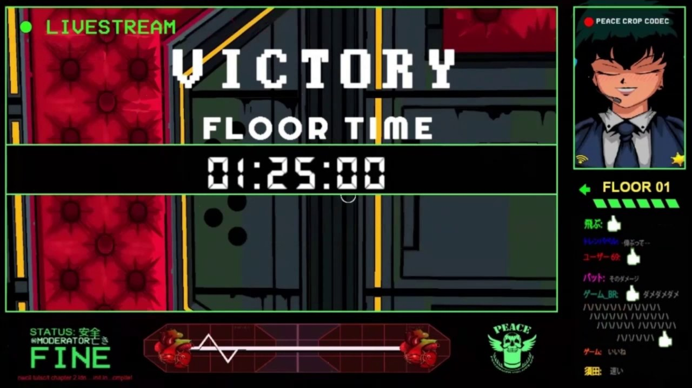 

- 클리어 시 스테이지 기록(FLOOR TIME)을 보여 주는 클리어 UI, 아이템 획득 UI(텍스트 포함), 보스 HP 바를 구현했습니다.

<br>

## 2. 몬스터 시스템

 

### 구조

- `CMonster` 를 공통 부모로 **Suit / Soldier / Fat / Drone** 을 구현했습니다. 공통 기능(빌보드, 사운드, 이펙트, 처치 UI, 콤보)은 부모에 두고, 몬스터별 차이는 `GetDeathUIConfig`, `Set_Check_Weapon` 등으로 재정의합니다.
- 각 몬스터는 **상태 머신**(`IDLE → CHASE → AIM → SHOT → AVOID → HIT → DEATH` 등)으로 동작하며, `OnEnterState` / `OnUpdateState` 로 진입 · 갱신 로직을 분리했습니다.
- 맞는 원인에 따라 `HIT_SHOTGUN`, `HIT_KATANA`, `HIT_ELECTRIC`, `HIT_DOOR`, `KICKED` 같은 **전용 피격 상태**로 전환해 연출을 다르게 했습니다.
- 2D 스프라이트 몬스터는 **빌보드**로 카메라를 바라보게 하고, 상태에 따라 텍스처 애니메이션을 교체합니다.

### 부위 판정 (Head / Body / Balls / Leg)

- 몬스터마다 `SetupHitSpheres` 로 **부위별 충돌 구체**(오프셋 · 반지름 · 우선순위)를 만들어, 겹치는 구체 중 **우선순위가 높은 부위**가 맞은 것으로 판정합니다. (머리 > 급소 > 몸통 > 다리)
- `ApplyDamage(HIT_PART, dmg)` 에서 부위와 무기(샷건 등)에 따라 데미지를 처리하고, **치명타 여부에 따라 처치 종류(Normal / Head / Balls)** 를 기록해 UI · 사운드 · 이펙트를 결정합니다.
- 헤드샷 시 머리 폭발 이펙트(`Spawn_HeadExplosion_Effect`)와 전용 사운드가 재생됩니다.
- `DebugRender_HitSpheres` 로 판정 구체를 화면에 그려 **디버깅**할 수 있게 했습니다.

### 스나이퍼 모드

- 스나이퍼 스테이지에서는 몬스터가 `ForceSniperMode` 로 저격 전용 동작으로 전환되며, **레이저(`UpdateLaser`)로 조준선**을 표시합니다.

### 드랍 · 이펙트 · 사운드

- 피격 / 폭발 / 전기 / 환풍구 이펙트와 처치 · 헤드샷 · 칼 피격 · 전기 사운드를 상황별로 재생합니다.

<br>

## 3. 충돌 / 피킹

<!-- 📷 콜라이더 · 히트 구체 디버그 렌더

-->

### 충돌 (`CColiderManager`) — Sphere · Cube 충돌 추가

- **충돌 그룹** 단위로 관리하고, 그룹 간 충돌만 검사합니다.
- `Sphere-Cube`, `Cube-Sphere`, `Cube` 충돌 판정을 구현해 몬스터 · 총알 · 지형 간 충돌에 사용했습니다.
- 소유자의 Sphere 와 대상의 Sphere 를 **태그로 지정**해 검사(`CollisionGroupSphereTag`)하여 부위별 판정에 활용했습니다.

```cpp
// 충돌 검사 예시
_vec3 vDist;
if (CColiderManager::GetInstance()->CollisionGroup(
        CColiderManager::COLLISION_MONSTER, pPlayer,
        CColiderManager::COLLISION_SPHERE, &vDist))
{
    // 충돌 처리
}
```

### 피킹 (`CPickingManager`)

- 조준점 방향의 레이와 피킹 대상 그룹(`Add_PickingGroup` / `Remove_PickingGroup`)의 교차를 검사해 **가장 가까운 대상**을 선택하도록 구현했습니다. 거리(z 값) 판단 기준을 수정해 겹친 대상이 올바르게 선택되도록 했습니다.
- 몬스터 사망 시 피킹 · 충돌을 즉시 해제하고, 씬 전환 시 `Clear_Picking` 으로 초기화해 **잔여 포인터로 인한 오류**를 방지했습니다.

<br>

## 4. 프러스텀 컬링 (`CCullingManager`)

<!-- 📷 컬링 On/Off 비교 (오브젝트 수 · FPS 표기)
 
-->

- 카메라의 View · Projection 행렬에서 **프러스텀 6개 평면**을 구하고, `Is_In_Frustum(위치, 반지름)` 으로 오브젝트가 화면 안에 있는지 판단합니다.
- 화면 밖 오브젝트는 렌더 대상에서 제외해 타일 · 벽 · 장식이 많은 스테이지의 부하를 줄였습니다.

<br>

## 5. 씬 구성 및 로딩

### 로고 / 로딩 씬

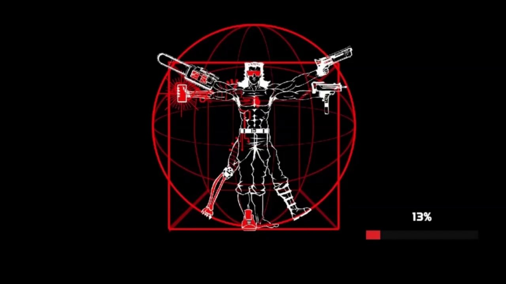 

- `CLoader` 가 **별도 스레드**(`_beginthreadex`)에서 다음 씬에 필요한 리소스를 로드하고, `CRITICAL_SECTION` 으로 진행 상태를 보호합니다.
- 로딩을 `PhaseBegin(base, weight)` / `PhaseStep` / `PhaseDone` 으로 나누어 **단계별 가중치로 진행률을 계산**하고 로딩 화면의 퍼센트 · 메시지에 반영했습니다.
- 씬(Logo, Dev, Tutorial, Stage, Snipe, Rooftop, Road)별 로딩 함수를 분리해 필요한 리소스만 불러오도록 했습니다.

### 스나이퍼 스테이지 (`CStage_Snipe`)

- 몬스터를 순서대로 활성화(`ActivateNext`)하고, 처치 수를 추적(`TickDeathsAndProgress`)하여 **남은 적 수를 아이콘 UI** 로 보여 줍니다.
- 모든 적을 처치하면 로딩 씬을 거쳐 보스 스테이지로 이동합니다.

### 영상 재생 (`CVideo`)

- **Media Foundation(`IMFSourceReader`)** 으로 영상을 디코딩해 텍스처로 출력하는 UI 오브젝트를 구현하고, 로고 씬에서 사용했습니다.

<br>

## 6. 칼 (Katana) 콤보


- 칼 오프닝(꺼내기) 연출과 **3단 콤보**를 구현했습니다. 콤보 입력 제한 시간(`m_fComboWindow`) 안에 다음 공격이 들어오면 단계가 이어지고, 시간이 지나면 콤보가 초기화됩니다.
- 칼에 맞은 몬스터는 전용 피격 상태(`HIT_KATANA`, `KATANA_DEATH`)와 피격 사운드가 재생됩니다.

<br>

## 7. 사운드 매니저 (`CSound_Manager`)

- **FMOD** 기반의 싱글톤 사운드 매니저를 엔진에 추가했습니다.
- 사운드 폴더를 순회하며 파일을 읽어 **키(wstring) → `FMOD::Sound`** 맵으로 등록하고, 이후에는 키만으로 재생합니다.
- 채널 32개를 ID 로 관리하며 `PlaySoundW`, `PlayBGM`, `PlaySoundPitch`(피치 변경), `StopSound`, 채널별 볼륨 조절 / 일시정지를 지원합니다.
- 몬스터 · UI · 칼 사운드를 적용했고, 팀원이 같은 API 로 무기 · 플레이어 · 보스 사운드를 추가했습니다.

<br>

# *기술적 요소*

자세한 코드 설명은 깃허브 프로젝트 혹은 기술소개서에서 확인 가능합니다.

- UI 상속 구조 · 트윈 애니메이션 · 연출 파이프라인
- 몬스터 상태 머신, 부위별 히트 스피어 판정
- Sphere / Cube 충돌, 피킹 매니저
- 프러스텀 컬링
- 로딩 스레드, 진행률 계산
- Media Foundation 영상 재생
- FMOD 사운드 매니저

<br>

# *트러블 슈팅 / 배운 점*

> 초안입니다. 실제 겪은 사례로 다듬어 주세요.

| 문제 | 해결 |
|---|---|
| 씬 전환 후 Picking 대상의 잔여 포인터 문제 | 씬 전환 시 `Clear_Picking`, 사망 시 `Remove_PickingGroup` 처리 |
| 팀원이 UI 를 각자 만들면 코드 중복 발생 | `CUI` 공통 베이스와 `CUIManager` 로 생성 · 애니메이션 통합 |
| 몬스터 부위가 겹쳐 헤드샷이 일반 피격으로 처리됨 | 부위 구체에 **우선순위**를 두어 겹칠 때 높은 우선순위 부위를 선택 |

<br>

# *실행 방법*

1. Visual Studio 2022 에서 `Frame156.sln` 을 엽니다. (Debug / Release, **x86**)
2. `Engine` → `Client` 순으로 빌드합니다. (`Copy.bat` 이 Engine.dll / 라이브러리를 복사)
3. `Client/Bin/Client.exe` 를 실행합니다. 맵 편집은 `Editor` 프로젝트를 실행합니다.
